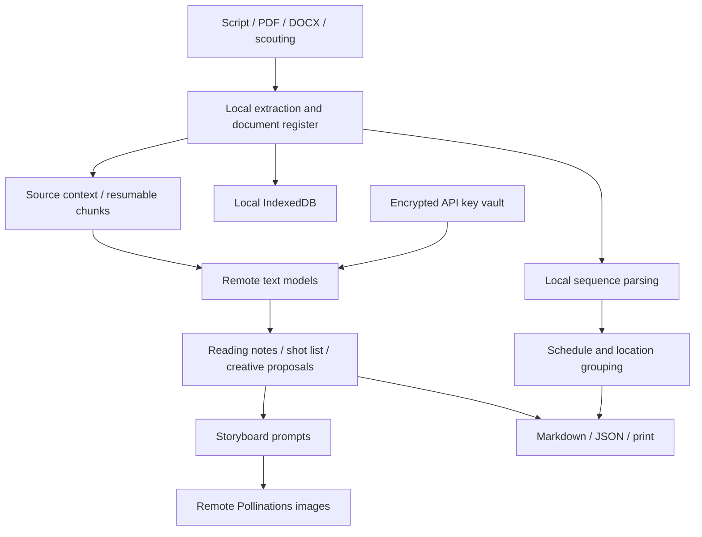

# Vision-IA

> **Projet signature · 01/06 · CINÉMA** — [Étude de projet : problème, choix techniques et limites](https://github.com/Nikoju1977/Nikoju1977/blob/main/SHOWCASE.md) · [Portfolio Studio Niko Design](https://github.com/Nikoju1977).

Vision-IA est un réalisateur agentique de cinéma, pensé pour accompagner un projet du pitch au dossier de production sans serveur applicatif ni chaîne de build.

L'application tient dans `index.html` et fonctionne comme une PWA. Elle lit des documents de travail, construit le contexte du film, produit une note d'intention, un découpage technique, un conducteur, un parti pris d'image, des directives de production et un dossier exportable.

**STUDIO NIKO DESIGN** · Build smart. Stay lightweight. Create without limits.

  

> [Insérer ici un GIF de démonstration / Insert demo GIF here]

## Pourquoi ce projet ?

Relier l'analyse documentaire et la direction artistique d'un film à un dossier de production cohérent, sans imposer de serveur applicatif. Les calculs de conducteur et la discipline des sources sont distincts des propositions créatives des modèles. Vision-IA est un outil de préproduction, pas un moteur local de génération vidéo.

## Architecture & algorithmes

| Fonction dans [index.html](index.html) | Implémentation constatée |
| --- | --- |
| Extraction documentaire | pdf.js 3.4.120 et Mammoth 1.6.0 (CDN) ; plafond de 400 pages PDF texte et 900 000 caractères par pièce. Pas d'OCR généralisé démontré. |
| `contexte`, `socle` | Assemblage de la fiche projet et des extraits ou notes de lecture ; instructions de séparation faits, hypothèses et propositions. |
| `strategieDepouillement`, `tailleTrancheDepouillement` | Routage adaptatif, tranches d'environ 3 000 ou 9 000 caractères et reprise par offsets. |
| `creerBatchDepouillement` | Chemin batch Mistral présent : envoi de portions et suivi d'un job distant, soumis aux conditions et tarifs du fournisseur. |
| `sequencesDuFilm`, `rendreConducteur` | Calcul local du conducteur à partir des en-têtes et des séquences identifiées. |
| `tirerStoryboard` | Jusqu'à 24 vues, URL Pollinations contenant le prompt, demande 1024×576 et seed par plan. Pas de moteur de diffusion local. |
| [sw.js](sw.js) | Cache applicatif et ressources de lecture ; les appels distants restent soumis au réseau. |

### Performances, fidélité et limites

Les plafonds de caractères, pages et images sont des limites programmées, pas un benchmark. Un texte long peut être tronqué ; l'extraction PDF ne garantit pas l'ordre de lecture, et les instructions de fidélité n'empêchent pas les hallucinations. Un découpage verrouillé à une source ne démontre pas la justesse de toutes les propositions. Les modèles configurés (Mistral, Groq, Cerebras, Ministral et Pollinations) sont des connecteurs externes ; leur disponibilité, coût, compatibilité et qualité ne sont pas vérifiés pour cette révision. Aucun rendu vidéo, codec, mixage audio ou moteur de diffusion local n'est revendiqué.

### Sécurité des données de production

Le coffre de clés utilise AES-256-GCM et PBKDF2-SHA-256 (310 000 itérations), sel de 16 octets, IV de 12 octets et phrase d'au moins 8 caractères. Les anciennes clés en clair peuvent être reprises en mémoire ; la purge intervient lors du scellement réussi du coffre. Il faut donc vérifier les migrations, et ne pas promettre une absence absolue de secrets historiques. Le coffre ne chiffre pas les corps de documents IndexedDB, les métadonnées de projet ni les exports JSON/Markdown. Les extraits de scénarios, notes, images et informations de production peuvent être transmis aux fournisseurs choisis ou intégrés aux URLs de storyboard ; le mode batch envoie des portions de documents à Mistral. Obtenir les droits et accords nécessaires avant de transmettre un scénario inédit, des rushes ou des données personnelles. La protection au repos ne couvre pas une session compromise.

Aucun benchmark de dépouillement, test d'inférence, test sur appareil physique, vérification de tarifs ou audit indépendant n'a été réalisé pour cette révision documentaire.

## Phases de travail

1. **Plateau** — dialogue avec Vision-IA et classeur du film.
2. **Note d'intention** — sujet, mise en scène, image/son et direction d'acteurs.
3. **Découpage technique** — plans, échelles, mouvements, focales, angles, durées et intentions.
4. **Conducteur** — séquences, I/E, moments, durée estimée et regroupement par décor.
5. **Parti pris d'image** — palette, matière, lumière, optiques et références.
6. **Production** — casting, repérages, équipe, matériel, musique, son et risques.
7. **Dossier** — Markdown, sauvegarde JSON et impression propre.

## Sources et cohérence

Les documents du classeur sont la source factuelle du projet. Vision-IA sépare désormais :

- les informations réellement présentes dans les documents ;
- les déductions ;
- les propositions de mise en scène ;
- les éléments à vérifier.

Lorsqu'une séquence de scénario est choisie pour le découpage, son texte devient la **source unique de la séquence**. Le découpage est lié à cette source par un identifiant persistant ; « Ajouter des plans » refuse de mélanger deux séquences différentes.

Pour les projets historiques et documentaires, les prompts interdisent d'introduire comme faits des personnages, lieux, dates, objets, événements ou causalités absents des sources.

## Classeur du film

Formats lus :

- PDF texte, jusqu'à 400 pages ;
- DOCX ;
- TXT, Markdown, Fountain, FDX, RTF et CSV ;
- images de repérage.

Les corps de texte sont conservés dans IndexedDB ; les métadonnées du projet utilisent `safeStorage`. Jusqu'à 900 000 caractères sont conservés par pièce.

La détection distingue scénario, livre et texte. Les séquences de scénario alimentent le Conducteur et le sélecteur de Découpage ; les chapitres d'un livre ne sont plus proposés comme séquences de tournage.

## Dépouillement des documents longs

Le dépouillement est reprenable. Chaque fiche réussie est sauvegardée immédiatement avec un offset de progression.

Routage actuel :

- si **Groq** est configuré et qu'il reste plus de 60 000 caractères, le document long est traité en priorité par Groq par tranches d'environ 9 000 caractères, avec repli automatique vers Mistral si Groq est indisponible ;
- sinon, avec Mistral, le mode économique travaille par tranches d'environ 3 000 caractères et peut basculer sur Groq ;
- sans Mistral, Groq/Cerebras assurent le secours ;
- un `429` ou un `5xx` déclenche refroidissement, reprise bornée et bascule vers un moteur disponible ;
- le `Retry-After` du fournisseur est respecté.

La synthèse finale utilise un prompt de **script analyste**, pas le prompt créatif du réalisateur, afin d'éviter qu'une proposition artistique devienne un fait du scénario.

## Moteurs

Chaîne générale :

- **Mistral** — `mistral-small-latest` ;
- **Groq** — `openai/gpt-oss-20b` ;
- **Cerebras** — `llama-3.3-70b`.

Pour l'analyse visuelle des repérages, Vision-IA utilise **Ministral 3** via `ministral-3b-latest`.

En dépouillement économique, si Mistral est temporairement limité, Vision-IA pénalise le fournisseur et bascule immédiatement vers Groq lorsqu'il est disponible. Un fournisseur encore en refroidissement passe derrière les moteurs prêts.

Les quotas réels dépendent du compte et du fournisseur ; l'application ne suppose pas de seuil universel.

## Sécurité des clés

Les clés API passent toutes par `sanitizeKey()`.

Les nouvelles clés sont conservées en mémoire ou dans le coffre chiffré ; les anciennes traces en clair doivent être migrées :

- coffre AES-256-GCM ;
- clé dérivée par PBKDF2-SHA256, 310 000 tours ;
- sel aléatoire de 16 octets ;
- IV aléatoire de 12 octets renouvelé à chaque écriture ;
- phrase de passe jamais persistée ;
- sans phrase de passe, les clés restent uniquement en RAM et disparaissent au rechargement.

L'analyse d'image lit elle aussi la clé Mistral dans ce coffre, et non dans le stockage en clair.

## Conducteur et plan de travail

Le Conducteur est calculé localement à partir des en-têtes de séquence, sans appel IA :

- nombre de séquences ;
- durée estimée ;
- décors distincts ;
- intérieurs/extérieurs ;
- séquences de nuit ;
- regroupement par décor.

Le Conducteur et le plan de travail par décor sont également intégrés au dossier Markdown.

## Storyboard

Le storyboard est construit depuis les plans du découpage avec Pollinations. Le prompt reprend l'échelle, l'angle, la focale, l'action, le genre, le décor et, lorsqu'elle existe, la palette du film. Un nouveau découpage de séquence efface les vues de l'ancienne source pour éviter la contamination.

## Export et impression

Le dossier conserve :

- titre et métadonnées ;
- note d'intention ;
- découpage et source verrouillée ;
- conducteur ;
- plan de travail par décor ;
- parti pris d'image ;
- directives de production ;
- repérages et notes de lecture.

À l'impression, seule la vue Dossier est imprimée. Les toasts, barres d'état, écrans de travail et autres phases ne sont plus capturés dans le PDF.

## Compatibilité et architecture

- application single-file : logique intégrée à `index.html` ;
- appels modèles en `XMLHttpRequest`, notamment pour la compatibilité Android/origine nulle ;
- pdf.js et Mammoth chargés depuis CDN et préchargés par le service worker ;
- `index.html` en réseau d'abord pour éviter de rester bloqué sur une ancienne version ;
- service worker versionné ;
- interface mobile avec `100dvh`, safe areas et champs à 16 px minimum.

## Qualité

La CI GitHub vérifie notamment :

- syntaxe JavaScript avec `node --check` ;
- garde-fous de cadence et reprise ;
- présence du routage Groq pour documents longs ;
- absence de l'ancien modèle Pixtral déprécié ;
- absence de lecture de clé Vision en clair ;
- discipline de source et verrouillage du découpage ;
- nettoyage de l'impression ;
- non-régression des anciens délais fixes.

## Quickstart / Démarrage rapide

Servir le dossier complet avec `python3 -m http.server 8000`, ouvrir http://localhost:8000/ (Web Crypto et PWA nécessitent un contexte sécurisé), ou utiliser GitHub Pages :

https://nikoju1977.github.io/Vision-IA/

---

Studio Niko Design

## Roadmap & contribution

Propositions non terminées :

- [ ] Tester extraction et découpage sur scénarios synthétiques, documents tronqués et PDF complexes.
- [ ] Mesurer débit, consommation de jetons, coût observé et reprise après interruption avec comptes de test autorisés.
- [ ] Vérifier la fidélité factuelle et les identifiants de source sur un jeu de référence annoté.
- [ ] Ajouter des contrôles de minimisation avant envoi et de chiffrement des documents de production ; vérifier la migration des clés historiques.
- [ ] Tester les exports et le storyboard, sans promettre la cohérence visuelle des images générées.

**Première contribution / `good first issue` (label proposé, non créé ici) :** Proposer un mini-scénario fictif contenant des en-têtes ambigus et le conducteur attendu.

[Issues](https://github.com/Nikoju1977/Vision-IA/issues) : retours reproductibles bienvenus dans le cadre des droits existants. Ne pas publier de clés, médias privés ou documents confidentiels.

## English overview

Vision-IA is a filmmaking preproduction workspace, not a video generator. It extracts documents locally, builds source-linked context, routes optional remote LLM requests and creates a local scene schedule plus storyboard prompts for Pollinations. The API-key vault uses AES-GCM/PBKDF2, but documents and project exports are not encrypted by it. Legacy cleartext keys may remain until successful vault sealing. Source-discipline prompts reduce but do not eliminate hallucinations. No new provider, benchmark or production tests were run.

## Licence & auteur / License & author

[Notice de droits](LICENSE.md) © 2026 Studio Niko Design (Nikoju1977). Tous droits réservés pour les contributions originales concernées. Publication publique ≠ licence open source ; les droits et licences tiers demeurent applicables. Aucun fichier de licence n'a été modifié.
